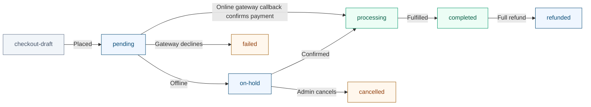

# wc-order-statuses
WooCommerce order statuses explained

A working reference to WooCommerce order statuses - what pending, on-hold, processing, failed, completed, cancelled and refunded each mean, who sets them, which ones send email, and how to audit orders that are stuck.

A WooCommerce order status is not a label someone types in - it is a state that a specific piece of code moved the order into, and every transition leaves a trace. If orders are piling up in on-hold, an offline gateway or a webhook that never arrived put them there. If pending payment orders accumulate, shoppers reached the payment page and left. If a customer swears they never got an email, the order almost certainly never crossed the transition that sends one. This article covers all eight core statuses, the code path that sets each, which emails fire on which transitions, what happens to stock, and the queries that tell you where a stuck order actually is.

## How it works
Internally, every core status is stored with a wc- prefix: wc-pending, wc-processing, wc-on-hold, wc-completed, wc-cancelled, wc-refunded, wc-failed, and wc-checkout-draft. That prefix exists because the statuses were originally registered as WordPress post statuses and had to avoid colliding with pending, draft and publish. The prefix is an implementation detail you have to know about anyway: $order->get_status() returns the slug without it, while the database column, register_post_status() and the wc_order_statuses filter all use it with the prefix. Comparing the two forms directly is the single most common bug in status-handling code.

Stored status slugs use the `wc-` prefix; `$order->get_status()` returns them without it.

## Status descriptions

| Status | Stored slug | Meaning |
| --- | --- | --- |
| pending | `wc-pending` | No payment yet, stock untouched |
| on-hold | `wc-on-hold` | Awaiting an offline payment, stock reduced |
| processing | `wc-processing` | Paid, waiting on you to fulfil it |
| completed | `wc-completed` | Paid and fulfilled, downloads released |
| failed | `wc-failed` | Gateway rejected the payment attempt |
| cancelled | `wc-cancelled` | Cancelled by an admin or hold-stock timeout |
| refunded | `wc-refunded` | Full refund recorded |
| checkout-draft | `wc-checkout-draft` | Unfinished Checkout block order |
